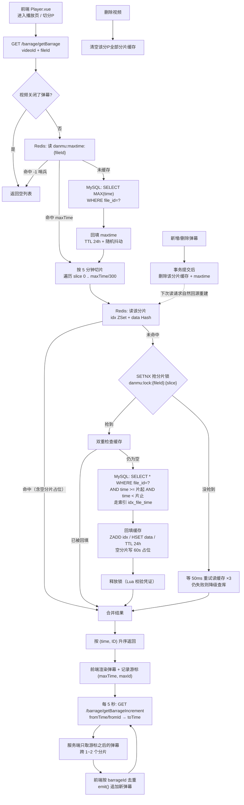

# PiliPili 视频网站

一个仿 B 站的视频分享平台，包含**用户端**与**管理后台**。实现了视频投稿转码、HLS 播放、分区浏览、ES 中文搜索、弹幕、评论、点赞投币收藏、关注、消息、合集、创作中心数据统计，以及后台审核与用户管理。

## 技术栈

| 层 | 技术 |
|---|---|
| 后端 | Spring Boot 2.7.6、MyBatis、Maven 多模块（common / web / admin） |
| 数据库 | MySQL 8.0 |
| 缓存 | Redis（登录态、上传状态、任务队列、热词榜、**视频详情缓存**） |
| 搜索 | Elasticsearch 7.17 + IK 中文分词（高亮、搜索建议） |
| 视频处理 | ffmpeg 9.x（HLS 切片：`.ts` + `index.m3u8`） |
| 前端 | Vue 3、Vite 6、Element Plus、Pinia、Vue Router、Axios |
| 播放器 | artplayer + hls.js + 弹幕插件 |
| 图表 | ECharts |
| 测试 | JUnit 5、Mockito、AssertJ |

## 目录结构

```
PiliPili/                      后端（Maven 多模块）
├── PiliPili-common/           公共层：实体、Mapper、Service、Redis/ES 组件、工具类
├── PiliPili-web/              用户端接口服务（端口 7071）
└── PiliPili-admin/            管理后台接口服务（端口 7070）

PiliPili-front/                前端
├── PiliPili-front-web/        用户端（端口 3000）
└── PiliPili-front-admin/      管理后台（端口 3001）

docs/                          文档
├── 改动记录.md                 本项目的问题修复与功能改动全过程
├── 面试知识点.md               改动涉及的面试知识点整理
├── Redis运维速查.md            Redis 状态查看、缓存验证、排查 SOP
├── redis_status.ps1            一键 Redis 状态面板脚本
└── sql/init.sql               数据库建表脚本（15 张表 + 分类基础数据）
```

## 核心实现亮点

- **分片上传 + 断点续传**：上传状态存 Redis（`uploadId` / `chunkIndex` / `fileSize`），支持大文件续传
- **异步转码**：Redis List 作为轻量队列，后台线程消费并通过 ffmpeg 转 HLS
- **视频详情缓存**：Cache-Aside 模式，并做了缓存三件套防护
  - 防穿透：空值占位对象 + 短 TTL
  - 防击穿：Redis 分布式锁 + 双重检查
  - 防雪崩：TTL 随机抖动
  - 一致性：缓存删除放在**事务提交后**（`afterCommit`）
- **弹幕分片缓存 + 增量拉取**：按 5 分钟分片存 Redis（ZSet 索引 + Hash 内容分离），未命中回源 MySQL 并回填（TTL 24h）
  - 防大 key：索引（`score=时间, member=弹幕ID`）与内容（`field=弹幕ID → JSON`）分开存，单 key 只覆盖一个时间片
  - 防穿透：空分片写 60s 占位；整条视频无弹幕时用 `-1` 哨兵
  - 防击穿：分片级分布式锁 + 双重检查，50 并发只回源 1 次
  - 增量拉取：客户端带 `(时间, ID)` 游标 5 秒轮询，只取新增弹幕并用 `emit()` 追加，不再全量重拉
- **ES 搜索**：IK 分词 + 关键词高亮 + 搜索热词 ZSet 榜
- **AOP 鉴权**：`@GlobalInterceptor(checkLogin = true)` 注解式登录校验

## 弹幕缓存实现流程

> 设计取舍与面试要点见 [`docs/弹幕Redis方案.md`](docs/弹幕Redis方案.md)。



**关键点**：读路径**不写 MySQL**，只有缓存未命中才回源一次并回填；写路径（新增/删除弹幕）只做**缓存失效**，下次读请求自然重建——这正是 Cache-Aside 的标准姿势。

## 快速开始

### 1. 环境依赖

| 组件 | 版本 | 说明 |
|---|---|---|
| JDK | 1.8 | 项目编译级别为 1.8 |
| Maven | 3.6+ | 建议配置国内镜像加速依赖下载 |
| MySQL | 8.0 | 端口 3306 |
| Redis | 3.2+ | 端口 6379 |
| Elasticsearch | 7.17.x + **IK 分词插件** | 端口 9200，索引使用 `ik_max_word` 分词 |
| ffmpeg | 4.x+ | 需在 PATH 中，转码与时长探测用 |
| Node.js | 18+ | 前端构建 |

### 2. 初始化数据库

```bash
mysql -uroot -p -e "CREATE DATABASE pilipili DEFAULT CHARACTER SET utf8mb4"
mysql -uroot -p pilipili < docs/sql/init.sql
```

### 3. 修改配置

按本机实际情况调整：

- `PiliPili-web/src/main/resources/application.yml`
- `PiliPili-admin/src/main/resources/application.yml`

```yaml
spring:
  datasource:
    url: jdbc:mysql://127.0.0.1:3306/pilipili?...
    username: root
    password: 你的密码
  redis:
    host: 127.0.0.1
    port: 6379
project:
  folder: F:/webServe/PiliPili/     # 视频/封面文件存储根目录，需自行创建
```

> ⚠️ Redis 需开启 key 过期事件通知（在线观看人数依赖）：
> 启动时加 `--notify-keyspace-events Ex`，或写入 redis 配置文件。

### 4. 启动

```bash
# 后端（先打包）
cd PiliPili
mvn clean package
java -jar PiliPili-web/target/PiliPili-web-1.0.jar
java -jar PiliPili-admin/target/PiliPili-admin-1.0.jar

# 前端
cd PiliPili-front/PiliPili-front-web   && npm install && npm run dev
cd PiliPili-front/PiliPili-front-admin && npm install && npm run dev
```

访问：

| 服务 | 地址 |
|---|---|
| 用户端 | http://localhost:3000 |
| 管理后台 | http://localhost:3001 |

### 5. 跑测试

> 父 pom 配置了 `<skipTests>true</skipTests>`，跑测试需显式关闭。

```bash
cd PiliPili
mvn test -DskipTests=false -Dtest=VideoInfoCacheTest -pl PiliPili-common
```

缓存集成测试需要本地 Redis（未启动时自动跳过）。

## 文档

- [`docs/改动记录.md`](docs/改动记录.md) —— 问题修复与功能改动全过程（含根因分析与涉及文件）
- [`docs/面试知识点.md`](docs/面试知识点.md) —— 改动涉及的面试知识点（缓存三件套、分布式锁、序列化、事务、测试、Redis 运维等）
- [`docs/Redis运维速查.md`](docs/Redis运维速查.md) —— 怎么看 Redis 状态、怎么验证缓存生效、故障排查 SOP

## 怎么查看 Redis 状态

```powershell
# 一键状态面板：连通性 / 内存 / 命中率 / 每个 key 的类型+TTL / 持久化 / 慢查询
powershell -ExecutionPolicy Bypass -File docs\redis_status.ps1
powershell -ExecutionPolicy Bypass -File docs\redis_status.ps1 -BigKeys            # 附带大 key 扫描
powershell -ExecutionPolicy Bypass -File docs\redis_status.ps1 -MonitorSeconds 10  # 实时看命令流

# 只想确认活着
& "G:\redis\Redis-x64-3.2.100\redis-cli.exe" ping
```

详细的指标解读、命令速查表与排查流程见 [`docs/Redis运维速查.md`](docs/Redis运维速查.md)。

## 文档维护约定

> 后续任何**涉及面试知识点**的代码改动，都会自动同步记录：
> 1. 在 `docs/改动记录.md` 追加一条（改了什么 / 为什么改 / 涉及文件 / 知识点）；
> 2. 在 `docs/面试知识点.md` 补充对应知识点的原理与项目落地方式。
>
> 纯配置、纯文案类改动不入文档，避免流水账。

## 已知待优化项

- [ ] 弹幕写路径改造：`INCR` 生成弹幕 ID + write-behind 异步批量落库 + 计数 Redis 化（消除 `video_info` 热点行）+ ES 更新移出事务
- [ ] 点赞/投币/收藏状态用 Set 或 Bitmap 判重（当前每次查库，且 `user_action` 缺唯一索引）
- [ ] 热榜改用 ZSet（当前 `ORDER BY play_count` 走 MySQL）
- [ ] 接口限流（Redis + Lua 令牌桶）
- [ ] 转码队列升级为可靠队列（Redis Stream 或 MQ，当前 List 无 ack/重试）
- [ ] 上传分片改用 Bitmap，支持秒传判定
- [ ] 外部进程调用改用 `ProcessBuilder` + 超时控制（当前 `Runtime.exec` 拼接字符串）
- [ ] 前端 TypeScript 化 + ESLint/Prettier
